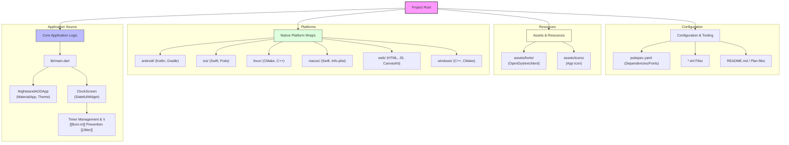
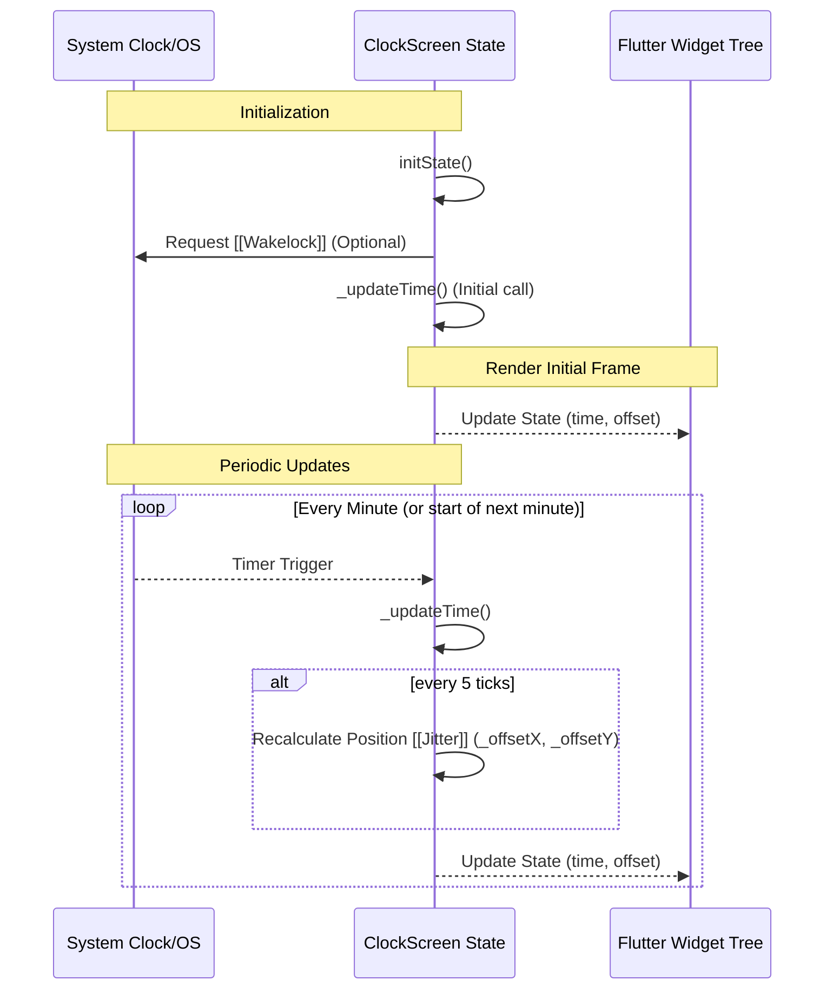

# Technical Architecture

## System Overview
The application follows a standard Flutter widget architecture. The `main.dart` file serves as the entry point, configuring system UI modes and initializing the app layout. See [[Features]] for implementation details.

## Component Diagram

## Data Flow
The application follows a reactive update pattern based on timers.

### Key Data Details
- **Input:** Current system time from `DateTime.now()`.
- **Processing:** 
  - High-frequency timer updates the string representation of time.
  - Every minute tick triggers a logic check for [[Burn-in]] Prevention using position [[Jitter]].
- **Output:** Updated UI via `setState`, displaying the formatted time in an oversized font with dynamic translation offsets.

## References
- [[Features]] - Functional details
- [[Development]] - Build and Design context
- [[Glossary]] - Definition of terms
