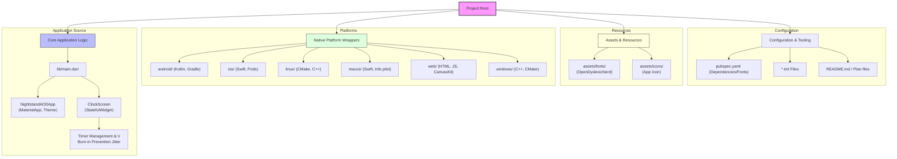

# Project Report: Nightstand AOD Clock

## Overview
The **nightstand_aod_clock** is a minimal, accessibility-focused "Always-On Display" (AOD) clock application designed for Android devices with AMOLED screens. It features a dyslexia-friendly font and includes burn-in prevention mechanisms specifically for static clock displays.

## Project Diagram

## Key Features
- **Dyslexia Friendly:** Uses the OpenDyslexic font.
- **AMOLED Optimized:** True black background to save power and prevent ghosting.
- **Burn-in Prevention:** Automatically jitters the clock position every 5 minutes.
- **Immersive UI:** Automatically hides status and navigation bars in sticky immersive mode.
- **Wakelock Support:** Maintains display activity on supported mobile platforms.

## Technology Stack
- **Framework:** Flutter
- **Language:** Dart, Kotlin (Android), Swift (iOS/macOS)
- **Key Packages:** `wakelock_plus`
